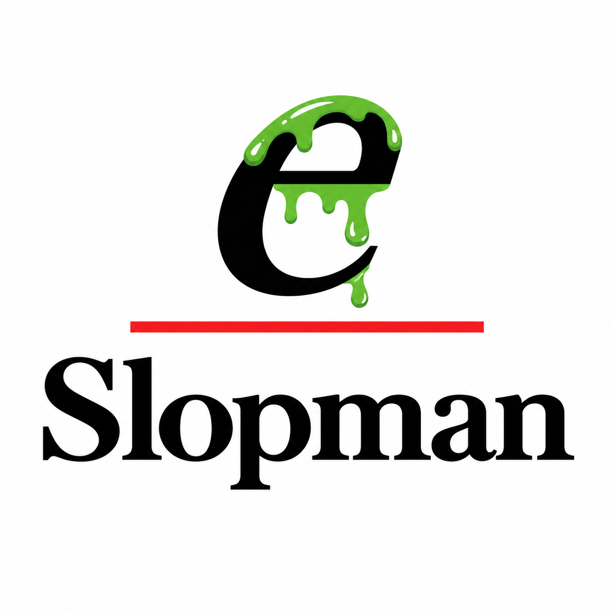

# e1647-rs

**An experimental, open-source Rust implementation of tooling for the IEEE 1647 _e_ hardware verification language.**

<p align="center">
  
  &nbsp;&#8594;&nbsp;
  
  <br>
  <em>Slopman (present) &#8594; Rustman (pending sufficient token expenditure).</em>
</p>

> **Status: pre-alpha.** Implements a source tokenizer and a parser for a
> declared subset of the language: struct/unit/extend/type declarations,
> fields, scalar/list/named and enumeral types, `keep`/`keep soft`
> constraints, `when` subtype members, ports, events and sequences, and
> methods with parameter lists and statement bodies (including `for`,
> `case`, `check that`, `wait`, `emit` and `start`), with diagnostic
> fixtures. `import` loads a sibling file. Member composition folds `like`
> chains and `extend` blocks into per-type member lists. The interpreter
> (`e1647 run`) executes that subset, including `print`/`out` and `gen` —
> a seeded rejection sampler by default, or a seeded solve of conjunctive
> linear constraints via the Pumpkin CP solver when the `solver-pumpkin`
> cargo feature is enabled. A single xezim VPI bridge (`src/hdl.rs`,
> `hdl_load` and quoted signal paths) drives one mixed SystemVerilog
> example. The clause 12 temporal-engine core (`src/temporal.rs`)
> propagates sampling events to sampled normal form and evaluates
> temporal expressions over explicit finite paths; the run loop drives
> it: `emit` feeds an event log, temporal `wait`s suspend until their
> expression succeeds, and `expect`/`assume` rules are checked at
> quit. It does **not** yet do full type
> checking, `when`-subtype
> resolution, event-driven temporal evaluation, coverage, non-linear or
> disjunctive constraint solving, or general testbench execution. No IEEE
> conformance is claimed. See [docs/ROADMAP.md](docs/ROADMAP.md) for the
> staged plan.

## From Slopman to Rustman

In keeping with this repository's policy of honest staged claims, the
mascot above is a status report. Everything here is authored by AI coding
agents under human review, and until the qualification corpus is complete
the honest word for that output is *slop*. Slopman wears his without
embarrassment: he is what this repository currently is — plausible, usefully
wrong in documented ways, and improving with every token.

He is not a permanent appointment. Every reviewed pull request, every
diagnostic fixture that earns its expected output, and every reference run
recorded in [docs/VERIFICATION.md](docs/VERIFICATION.md) burns more tokens
and drains a little more green from the *e*. No date is promised — only the
mechanism: work the staged plan in [docs/ROADMAP.md](docs/ROADMAP.md), keep
every claim matched by its tests, and one day, when enough tokens have been
burned, Slopman will quietly become Rustman. Same letter; less slime. Until
then, no conformance is claimed, and no cleanliness either.

## Goals

- Implement the language from independently developed Rust source code.
- Develop a reproducible conformance corpus for syntax, elaboration, random generation, temporal semantics, and coverage.
- Provide a usable CLI first, with an embeddable library and eventual WebAssembly target.
- Eventually integrate with open-source HDL simulators (including SystemVerilog and VHDL backends) via an explicit simulation API.

## Quick start

Requires a recent stable Rust toolchain supporting edition 2024.

```sh
cargo test
cargo run -- tokens examples/packet.e   # tokenize (does not parse)
cargo run -- parse examples/packet.e    # parse and print the AST or diagnostics
cargo run -- elab examples/methods_types.e  # fold like/extend, print the types
cargo run -- run --seed 1 examples/reference_subset.e  # execute sys.run()
```

With Docker, no local Rust toolchain is needed, and the pumpkin solver
feature can be verified on machines without a C compiler:

```sh
docker compose build               # build the toolchain image
docker compose run --rm verify     # fmt + clippy + tests, all features
docker compose run --rm demo       # run and elaborate the example programs
docker compose run --rm mixed      # mixed e + SystemVerilog testcase (xezim)
docker compose run --rm toolchain  # interactive shell in the container
```

`run` executes the built-in `sys` unit's `run()` methods. Every run takes
an explicit `--seed` and is fully deterministic per backend. By default
`gen` is a rejection sampler; with `solver-pumpkin` it solves conjunctive
linear `keep` constraints and falls back to rejection sampling for
anything else (see `src/interp.rs` for the exact semantics and its honest
limits).

## Repository layout

| Path | Contents |
| --- | --- |
| `src/` | The Rust crate (`lexer`, `ast`, `diagnostic`, `parser`, `check`, `elab`, `builtins`, `interp`, `solve`, `hdl`) and the `e1647` CLI |
| `c/` | The VPI control bridge for mixed e + SystemVerilog testcases (simulated by xezim; see `examples/mixed_counter.e`) |
| `Dockerfile`, `compose.yml` | The toolchain container (see Quick start) |
| `tests/` | Integration tests and `tests/fixtures/` diagnostic fixtures |
| `examples/` | Small e-language sources used by tests and the CLI |
| `docs/` | Architecture, roadmap, references and the verification log |
| `external/` | Pinned read-only reference repositories (see [external/README.md](external/README.md)) |
| `slopman-logo.png`, `rustman-logo.png` | The project mascot, present and prospective (see [From Slopman to Rustman](#from-slopman-to-rustman)) |

## Working on this repository

**Humans do not edit files here.** All changes are made by AI coding agents
and land through reviewed pull requests — see
[CONTRIBUTING.md](CONTRIBUTING.md). Agents follow
[AGENTS.md](AGENTS.md).

Verification before any pull request:

```sh
cargo fmt --all -- --check
cargo clippy --all-targets -- -D warnings
cargo test --all-targets
```

Reference runs against the Cadence Specman implementation use
[EDA Playground](https://www.edaplayground.com). Credentials are read from a
gitignored `.env` file (copy `.env.example`); they must never be committed.
The automation playbook (login, run setup, reading logs, saving) lives at
[skills/edaplayground/SKILL.md](skills/edaplayground/SKILL.md); reference
rules and lawful access to the IEEE 1647 standard are described in
[docs/REFERENCES.md](docs/REFERENCES.md).

## Standards and trademarks

This is an independent project targeting the IEEE 1647 _e_ language. The IEEE standard is copyrighted and must be obtained through appropriate channels; this repository does not redistribute the standard or proprietary Specman software.

**Specman®** is a registered trademark of Cadence Design Systems, Inc. This project is not affiliated with, sponsored by, or endorsed by Cadence Design Systems, Inc. References to Specman, if any, are descriptive only.

## License

Licensed under [Apache-2.0](LICENSE).

Contributions should be independently authored, without copying proprietary compiler/runtime code or proprietary verification libraries.
